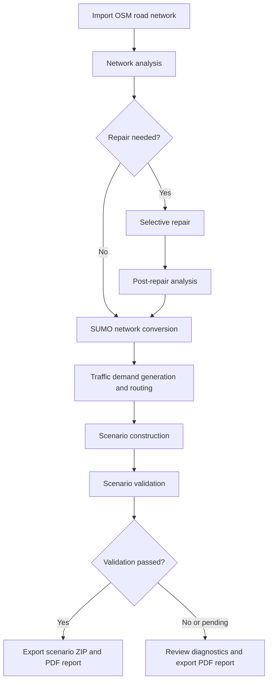

# OSM-to-SUMO: Road Network Analysis and Traffic Scenario Generation Framework

## 1. Objective

This framework provides a systematic and reproducible approach for transforming OpenStreetMap (OSM) road networks into executable SUMO traffic simulation scenarios. Unlike conventional conversion workflows, it integrates road network quality assessment, selective network repair, compatibility evaluation, traffic generation, and scenario validation within a unified environment.

The main objective is to improve the reliability and reproducibility of traffic scenario preparation for Intelligent Transportation Systems (ITS) research.

## 2. Main Contributions

| Contribution | Description |
| --- | --- |
| **1. Network diagnosis and compatibility assessment** | Identifies structural, topological, connectivity, permission, and attribute issues and evaluates OSM-to-SUMO compatibility. |
| **2. Selective network repair** | Allows users to select eligible repairs, preserves original data, and compares network quality before and after repair. |
| **3. Scenario validation and reproducibility** | Generates traffic scenarios, checks their operational readiness, and provides validation reports and reproducible simulation packages. |

## 3. Framework Workflow



## 4. Installation

### Prerequisites

- Python 3
- Eclipse SUMO, including its command-line utilities
- An OSM road network file in `.osm` XML format
- A web browser

Install SUMO from the [official website](https://sumo.dlr.de/docs/Downloads.php). Ensure that SUMO executables are accessible from the terminal. Verify the installation:

```bash
python --version
sumo --version
netconvert --version
duarouter --version
```

Open a terminal in the framework directory and install the Python dependencies:

```bash
python -m pip install -r requirements.txt
```

## 5. How to Test the Framework

### Step 1 — Launch the interface

```bash
python app.py
```

Open http://127.0.0.1:5000 in a web browser.

### Step 2 — Import an OSM network

Download or prepare an OSM XML file representing the study area. Import the `.osm` file through the interface. The maximum upload size is 100 MB.

### Step 3 — Analyze the road network

Click **Analyze** to inspect the original network. Review road types, structural errors, connectivity, vehicle permissions, missing attributes, and geometry findings. The pre-conversion compatibility assessment reports evaluated points and pending checks; it does not certify SUMO routing feasibility.

**Expected result:** a network diagnosis with quality indicators and eligible repair counts.

### Step 4 — Repair the network (optional)

Click **Repair…**, select applicable repairs, and apply them. Available operations include:

- Inferring missing speed limits or lane counts from the installed SUMO typemap.
- Removing eligible isolated nodes, small components, unsupported ways, or structurally invalid ways.
- Removing consecutive duplicate node references.

Review the before/after comparison and click **Re-analyze** if further inspection is needed. The original OSM file remains unchanged.

**Expected result:** a repaired OSM revision, updated analysis, and a repair audit. Inferred attributes are modeling assumptions rather than verified real-world measurements.

### Step 5 — Generate the traffic scenario

Proceed to the traffic-generation controls. Define the simulation duration and requested vehicle demand. For an initial test, use passenger vehicles, 100 requested vehicles, and a duration of 600 seconds (illustrative test parameters, not benchmark results).

Run traffic generation to create the SUMO network, trips, routes, configuration, and optional polygons. The requested demand determines the trip period (duration divided by demand). Routing may reject some trips, so the routed vehicle count can be lower than the requested count.

**Expected result:** a list of generated scenario files. Generation alone does not establish scenario readiness.

### Step 6 — Validate the scenario

In section 4, click **Validate Scenario**. The framework checks XML files, local configuration references, nonempty demand, and SUMO startup with all routes loaded and route-error checking enabled.

The startup test runs for at most 60 simulation seconds with a 120-second wall-clock timeout and requires at least one inserted vehicle.

| Status | Interpretation |
| --- | --- |
| PASS | Required checks and startup test succeeded. |
| FAIL | One or more required checks failed. |
| PENDING | Required validation evidence is unavailable, for example when SUMO is missing. |

**Expected result:** validation diagnostics and internal `scenario-report.json` and `scenario-report.pdf` files. A passing startup test does not guarantee that every trip finishes or that traffic is realistic.

### Step 7 — Export the scenario and report

Use **Export Report** to download the PDF containing parameters, demand figures, validation evidence, and an artifact inventory. It is available for passing, failed, and pending scenarios.

Export the scenario ZIP after validation passes. The framework verifies that the generated artifacts have unchanged SHA-256 hashes before allowing ZIP export.

The ZIP contains the network, trips, routes, configuration, optional polygons, and a README with execution instructions. The PDF is available separately.

Export before restarting the server because startup clears stored sessions. Repairing the source invalidates the current traffic-generation result.

### Step 8 — Execute the exported simulation

Extract the ZIP, open a terminal inside `Scenario_001`, and run:

```bash
sumo-gui -c scenario.sumocfg
```

Click **Play** to visualize vehicle movement. For execution without the graphical interface, run:

```bash
sumo -c scenario.sumocfg
```

**Expected result:** SUMO loads the exported scenario independently of the framework. Check the simulation output for any errors and, if full-trip completion is required, evaluate the complete run separately.

## 6. Suggested Test Cases

| Test | Procedure | Expected behavior |
| --- | --- | --- |
| Network diagnosis | Import a valid OSM file and analyze it. | Network quality indicators are produced. |
| Selective repair | Select eligible missing-speed or missing-lane repairs. | Eligible attributes are updated and an audit is produced. |
| Traffic generation | Request 100 passenger vehicles over 600 seconds. | Scenario files are generated; routed demand may be lower. |
| Scenario validation | Validate a usable scenario with SUMO installed. | PASS if all required checks succeed. |
| Invalid scenario | In a disposable test fixture, supply malformed XML or missing required references. | Validation cannot return PASS. |
| Missing SUMO | Test in an environment without SUMO. | Startup validation remains PENDING if other required checks pass. |
| Export integrity | Modify a generated artifact after passing validation in a disposable test run. | ZIP export is blocked until valid evidence is restored. |
| Reproducibility | Extract a passing scenario ZIP and run it independently. | The configuration and its local dependencies can be loaded by SUMO. |

These are proposed functional tests and expected outcomes, not observed experimental results.

## 7. Command-Line Interface (Optional)

Analyze a network without generating a scenario:

```bash
python osm_to_sumo.py --analyze-only
```

Run interactive analysis and select generation stages:

```bash
python osm_to_sumo.py --analyze
```

Apply selected repairs and generate all stages with explicit scenario validation:

```bash
python osm_to_sumo.py --osm network.osm --repair --repairs speeds lanes --steps all --no-gui --validate-scenario
```

Replace `network.osm` with the actual input path. Use `--output-dir DIRECTORY` to select the output directory. CLI validation is opt-in through `--validate-scenario`. Regenerate routes and configuration after changing the network.

## 8. Automated Tests

From the framework directory, run:

```bash
python -m unittest -v test_app.py test_network_analysis.py test_scenario_validation.py
```

These test modules cover the interface, network analysis and repair engine, and scenario validation. Review the test output to determine whether all tests pass.

## 9. Generated Artifacts

| Artifact | Purpose |
| --- | --- |
| `osm-analysis.json` | Original network diagnosis |
| `network.repaired.osm` | Repaired OSM network |
| `osm-analysis-repaired.json` | Post-repair diagnosis |
| `network-repair.json` | Repair audit and before/after comparison |
| `sumo-analysis.json` | Post-conversion network analysis |
| SUMO network, trips, routes, configuration and optional polygons | Executable scenario inputs |
| `scenario-report.pdf` | Human-readable validation report |
| `scenario-report.json` | Internal validation evidence |
| Scenario ZIP | Portable validated SUMO scenario |

Artifacts depend on the selected stages and interface or CLI execution path.

## 10. Limitations

- The framework does not automatically resolve all OSM geometry, topology, conditional access, or turn-restriction issues.
- Inferred speed limits and lane counts do not establish real-world accuracy.
- Mixed vehicle composition is rejected when unsupported.
- The compatibility score is a diagnostic rubric, not an official SUMO certification or calibrated probability.
- Startup validation establishes initial operational readiness only, not full-trip completion or traffic realism.

## 11. References

- [OpenStreetMap import in SUMO](https://sumo.dlr.de/docs/Networks/Import/OpenStreetMap.html)
- [SUMO command-line options](https://sumo.dlr.de/docs/sumo.html)
- [SUMO summary output](https://sumo.dlr.de/docs/Simulation/Output/Summary.html)
